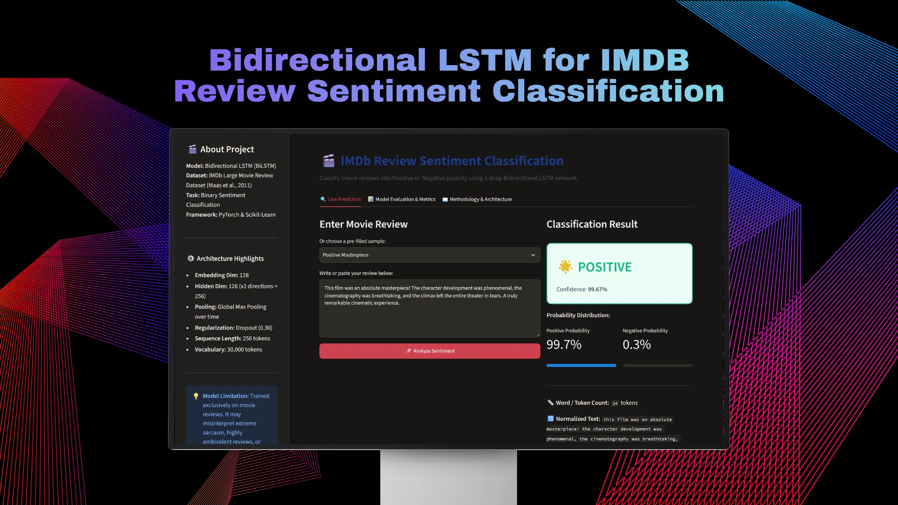
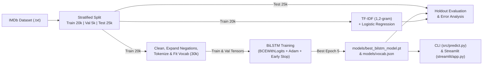
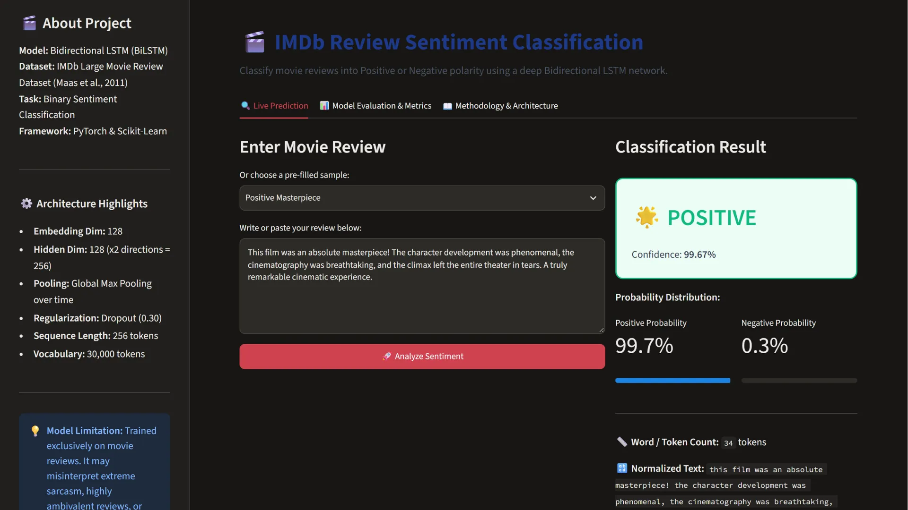
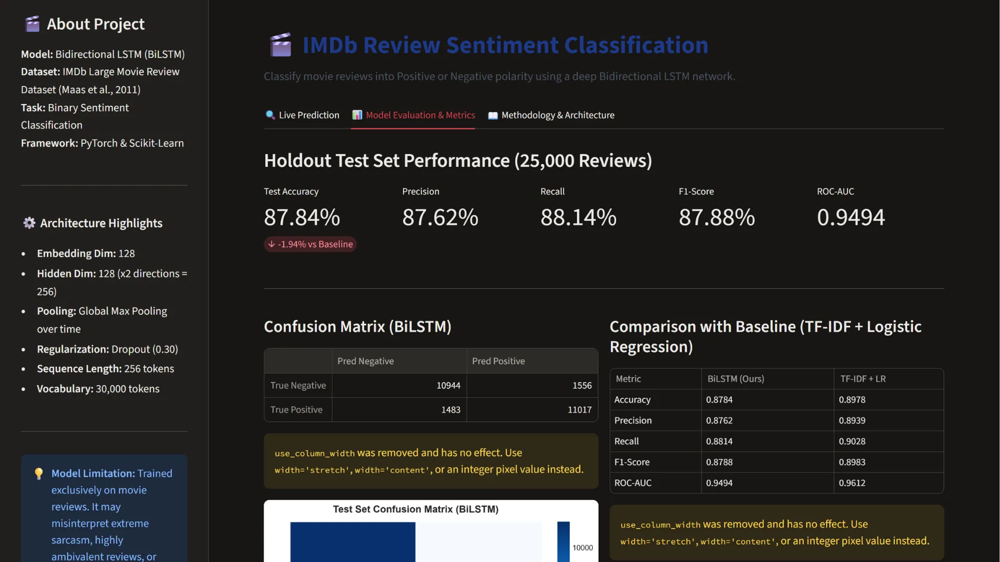
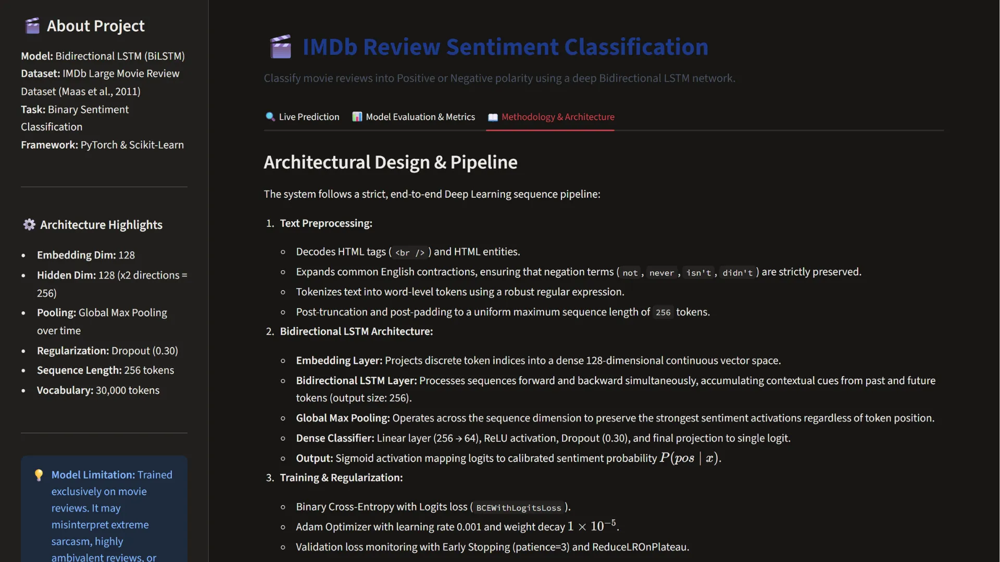
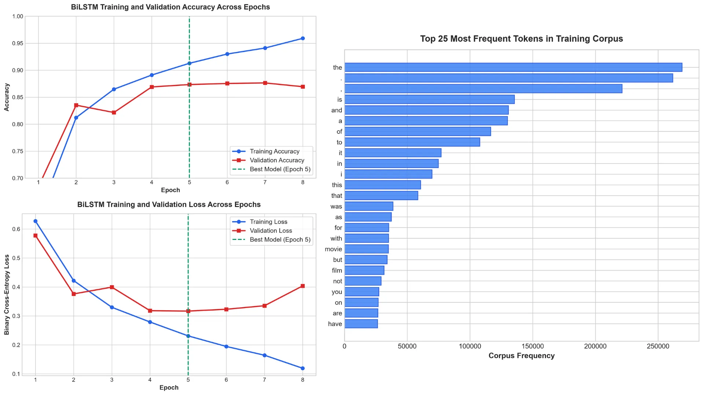
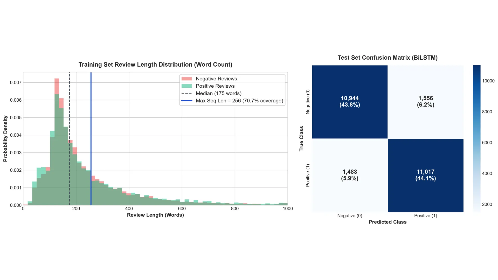
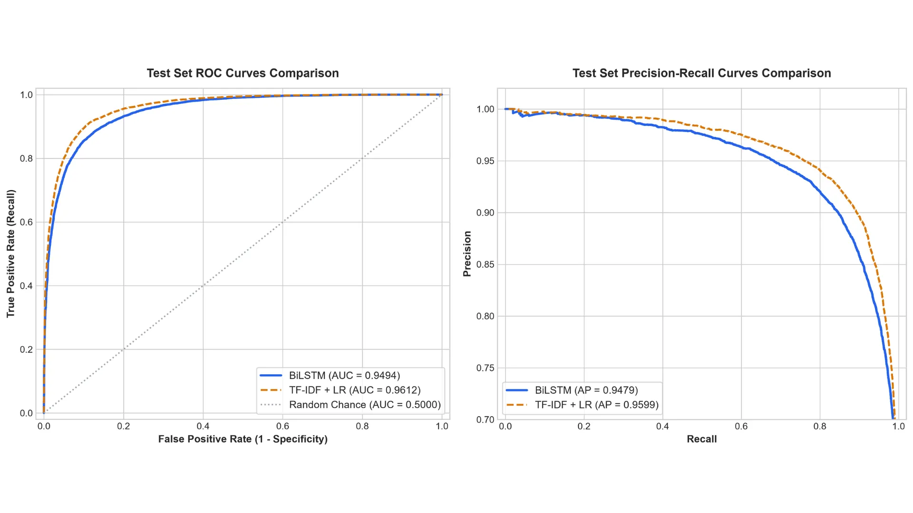
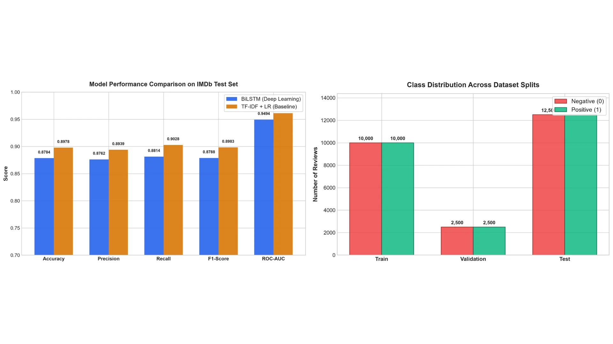

# Bidirectional LSTM for IMDB Review Sentiment Classification




-green)


## Project Overview

This repository implements an end-to-end Deep Learning sequence modeling pipeline for binary sentiment classification on the Stanford IMDb Large Movie Review Dataset. A PyTorch Bidirectional Long Short-Term Memory (`BiLSTMClassifier`) network processes tokenized movie reviews in both forward and backward temporal directions to classify each review as positive or negative sentiment, benchmarked against a sublinear TF-IDF and Logistic Regression baseline and deployed through an interactive Streamlit inference dashboard.

## Problem Statement & Objectives

Sentiment classification of long-form movie reviews is challenging due to syntactic inversions, long-range contextual dependencies, negation scopes, and mixed evaluations within a single document. Bag-of-words approaches discard word order, whereas recurrent sequence architectures can capture contextual transitions across tokens when paired with leakage-free preprocessing.

- Enforce strict partition isolation by separating the 25,000-review holdout test set from training, validation splitting, and vocabulary construction.
- Build a negation-preserving text normalization and tokenization pipeline that strips HTML artifacts while expanding contractions (`can't` to `can not`, `n't` to ` not`).
- Train and regularize a Bidirectional LSTM architecture with global max pooling over time, spatial embedding dropout, gradient clipping, and early stopping.
- Benchmark neural sequence performance against a TF-IDF n-gram Logistic Regression baseline on identical splits using Accuracy, Precision, Recall, F1-Score, and ROC-AUC.
- Perform systematic test-set error analysis and package the serialized model artifacts into a CLI predictor and Streamlit web interface.

## Data & Input Sources

The project uses the Large Movie Review Dataset (v1.0) by Maas et al. (2011), stored locally under `dataset/`. Only the 50,000 labeled reviews are used in the supervised pipeline; the 50,000 unlabeled reviews under `dataset/train/unsup/` are excluded. From the 25,000-review training pool, a stratified 80/20 split (seed `42`) produces 20,000 training and 5,000 validation samples, while the 25,000 test reviews remain an untouched holdout set.

| Attribute | Description |
| :--- | :--- |
| Dataset / Input Source | Stanford Large Movie Review Dataset (IMDb v1.0) |
| Source | Local `dataset/train/` and `dataset/test/` directories (Maas et al., 2011) |
| Format | Plain text `.txt` review files cached via `dataset/splits.pkl` |
| Samples / Records | 50,000 labeled reviews (20,000 train, 5,000 validation, 25,000 test) |
| Features / Input Shape | Token index sequences of fixed length `(Batch, 256)` |
| Target / Label | Binary sentiment (`0` = negative, `1` = positive; 50% / 50% balanced) |

## Data Preprocessing & Feature Engineering

Text preprocessing and integer encoding are implemented in [src/preprocessing.py](src/preprocessing.py) with vocabulary fitting restricted strictly to the 20,000-review training split to prevent data leakage.

| Transformation | Input | Output |
| :--- | :--- | :--- |
| HTML & Tag Cleaning | Raw review string with entities and `<br />` tags | Decoded plain text without HTML markup |
| Contraction & Negation Expansion | Contracted forms (`can't`, `won't`, `n't`, `'s`, `'re`) | Expanded canonical tokens (`can not`, `will not`, ` not`) |
| Regex Tokenization | Lowercased normalized text | Word and punctuation tokens (`\b[\w'-]+\b\|[!?,.:;]`) |
| Train-Only Vocabulary Mapping | Token list | Integer IDs (`V = 30,000`, `min_freq = 2`, `<pad>=0`, `<unk>=1`) |
| Sequence Alignment | Variable-length ID list | Post-truncated / post-padded sequence of length `256` |

1. Unescape HTML entities using `html.unescape` and strip `<br />` and residual HTML tags via regular expressions.
2. Expand English contractions and negation suffixes so sentiment-flipping cues remain explicit tokens.
3. Lowercase the text while preserving expressive punctuation (`!`, `?`, `.`, `,`, `:`, `;`) and extract tokens with regex matching.
4. Fit the `Vocab` frequency table exclusively on the 20,000 training reviews, retaining up to 30,000 tokens with minimum frequency `2`.
5. Encode all splits into fixed 256-token integer tensors via post-truncation and post-padding, covering approximately 70.7% of training reviews without truncation.

## Tech Stack

| Category | Technology | Purpose |
| :--- | :--- | :--- |
| Programming Language | Python | Core pipeline, modeling, evaluation, and application scripting |
| Deep Learning | PyTorch | `BiLSTMClassifier` definition, training loop, and `.pt` serialization |
| Classical ML & Metrics | Scikit-Learn | Stratified splitting, TF-IDF baseline, Logistic Regression, and evaluation metrics |
| Numerical & Data Processing | NumPy, Pandas, SciPy | Array computation, dataset split tables, and sparse matrix handling |
| Visualization | Matplotlib, Seaborn | Training curves, EDA distributions, confusion matrix, ROC, and PR plots |
| Serialization | Joblib, JSON, Pickle | Persistence for baseline pipeline, vocabulary index, metrics, and split cache |
| Interactive Interface | Streamlit | Web dashboard for live sentiment inference, metrics, and architecture docs |

## Machine Learning Approach

The system formulates sentiment polarity detection as binary sequence classification under a Deep Learning paradigm, using end-to-end learned token embeddings and recurrent hidden states, paired with a linear TF-IDF baseline for empirical comparison.

| Attribute | Value |
| :--- | :--- |
| Learning Paradigm | Deep Learning |
| Problem Domain | Natural Language Processing (Sentiment Analysis) |
| ML Task | Binary Sentiment Classification |
| Input | Padded word-and-punctuation index sequence `(Batch, 256)` |
| Target / Output | Sentiment logit and calibrated probability $P(y=1 \mid x) \in [0, 1]$ |
| Approach | Bidirectional LSTM with Global Max Pooling vs. TF-IDF + Logistic Regression |

## Model Overview

The primary model is `BiLSTMClassifier` defined in [src/model.py](src/model.py), containing **4,120,705 trainable parameters** trained from scratch without pretrained word embeddings.

| Attribute | Specification |
| :--- | :--- |
| Model Name | `BiLSTMClassifier` |
| Architecture | Embedding (`30,000 x 128`) -> Dropout (`0.30`) -> 1-Layer BiLSTM (`128` hidden/dir) -> Global Max Pool (`256`) -> Linear (`256 -> 64`) -> ReLU -> Dropout (`0.30`) -> Linear (`64 -> 1`) |
| Model Type | Bidirectional Recurrent Neural Network |
| Framework | PyTorch |
| Input | LongTensor of token IDs `(batch_size, 256)` |
| Output | Scalar sentiment logit `(batch_size,)` mapped via Sigmoid |
| Pretrained Status | Trained from scratch on IMDb training split (20,000 reviews) |

## ML Workflow

The end-to-end experimental workflow is modularized across `src/` and documented in [final_report.md](final_report.md).

1. **Data Ingestion & Stratified Partitioning** ([src/data_loader.py](src/data_loader.py)): Load labeled `.txt` reviews from `dataset/train/` and `dataset/test/`, create an 80/20 stratified train/validation split (`random_state=42`), and cache splits in `dataset/splits.pkl`.
2. **Text Cleaning & Vocabulary Construction** ([src/preprocessing.py](src/preprocessing.py)): Normalize HTML and negations, tokenize reviews, build a train-only 30,000-token vocabulary saved to `models/vocab.json`, and generate padded PyTorch `DataLoader` batches (`max_len=256`).
3. **Baseline Benchmarking** ([src/baseline.py](src/baseline.py)): Fit a sublinear TF-IDF vectorizer (unigrams/bigrams, `max_features=30000`) and L2-regularized Logistic Regression (`C=1.0`), saving `models/baseline_tfidf_lr.joblib` and `metrics/baseline_metrics.json`.
4. **BiLSTM Training & Checkpointing** ([src/train.py](src/train.py)): Train `BiLSTMClassifier` with `BCEWithLogitsLoss`, Adam, gradient norm clipping (`5.0`), `ReduceLROnPlateau`, and early stopping (`patience=3`), saving the best Epoch 5 weights to `models/best_bilstm_model.pt` and history to `metrics/training_history.json`.
5. **Holdout Test Evaluation** ([src/evaluate.py](src/evaluate.py)): Restore the Epoch 5 checkpoint and compute test loss, accuracy, precision, recall, F1-score, ROC-AUC, and confusion matrix on the untouched 25,000 test reviews (`metrics/bilstm_test_metrics.json`).
6. **Visualization & Error Analysis** ([src/visualize.py](src/visualize.py), [src/error_analysis.py](src/error_analysis.py)): Generate publication figures in `figures/` and extract top false positives, false negatives, and borderline cases into `metrics/error_analysis.json`.
7. **CLI & Interactive Serving** ([src/predict.py](src/predict.py), [streamlit/app.py](streamlit/app.py)): Expose `SentimentPredictor` for command-line and Streamlit web inference.

## ML Pipeline Architecture

The pipeline isolates the 25,000 holdout test reviews until final evaluation, fitting both the neural vocabulary and the baseline TF-IDF vectorizer exclusively on the 20,000 training split before feeding downstream training, evaluation, and interactive inference components.



## Model Training & Configuration

Training is configured in [src/config.py](src/config.py) and executed via [src/train.py](src/train.py) using deterministic random seeding (`42`). Optimization ran on CPU (`Intel Core i9-9900K`) for 8 epochs (`751.71` seconds total), achieving minimum validation loss (`0.31672`) at Epoch 5 before `ReduceLROnPlateau` halved the learning rate at Epoch 8 and early stopping triggered (`patience=3`).

| Parameter | Configured Value |
| :--- | :--- |
| Embedding Dimension | `128` |
| LSTM Hidden Dimension | `128` per direction (`256` bidirectional) |
| Number of LSTM Layers | `1` |
| Pooling Strategy | Global Max Pooling over sequence length (`256`) |
| Dense Hidden Layer | `64` units with ReLU |
| Dropout Rate | `0.3` (embedding dropout and dense dropout) |
| Loss Function | `nn.BCEWithLogitsLoss()` |
| Optimizer | Adam (`lr=1e-3`, `weight_decay=1e-5`) |
| LR Scheduler | `ReduceLROnPlateau` (`mode="min"`, `factor=0.5`, `patience=1`) |
| Gradient Clipping | Max L2 norm `5.0` |
| Batch Size & Max Epochs | `64` / `8` (Early stopping `patience=3`) |
| Random Seed | `42` |

```bash
python -m src.train
```

### Model Comparison & Selection

Both `BiLSTMClassifier` and the TF-IDF + Logistic Regression baseline were evaluated on the identical 25,000-review untouched test split. While the BiLSTM successfully models sequential negation patterns, the linear TF-IDF baseline achieved higher overall test metrics because it ingests full-length reviews without 256-token truncation and leverages n-gram counts directly without learning embeddings from scratch.

| Model | Split | Accuracy | Precision | Recall | F1-Score | ROC-AUC |
| :--- | :--- | :---: | :---: | :---: | :---: | :---: |
| `BiLSTMClassifier` (Epoch 5) | Holdout Test (25,000) | `0.8784` | `0.8762` | `0.8814` | `0.8788` | `0.9494` |
| TF-IDF + Logistic Regression | Holdout Test (25,000) | `0.8978` | `0.8939` | `0.9028` | `0.8983` | `0.9612` |

### Model Artifacts & Checkpoints

All trained checkpoints, vocabulary mappings, baseline pipelines, and evaluation logs are persisted under `models/` and `metrics/` for reproducible inference and reporting.

| Artifact | Format | Purpose | Location |
| :--- | :--- | :--- | :--- |
| `best_bilstm_model.pt` | PyTorch Checkpoint (`.pt`) | Epoch 5 BiLSTM weights, optimizer state, and model hyperparameters | `models/best_bilstm_model.pt` |
| `vocab.json` | JSON | Train-fitted 30,000-token dictionary and top-100 frequency metadata | `models/vocab.json` |
| `baseline_tfidf_lr.joblib` | Joblib | Serialized `TfidfVectorizer` and `LogisticRegression` classifier | `models/baseline_tfidf_lr.joblib` |
| `training_history.json` | JSON | Per-epoch train/val loss, accuracy, val F1, LR, and timing logs | `metrics/training_history.json` |
| `bilstm_test_metrics.json` | JSON | Holdout test metrics, confusion matrix, and per-sample predictions | `metrics/bilstm_test_metrics.json` |
| `baseline_metrics.json` | JSON | Holdout test metrics and predictions for TF-IDF + Logistic Regression | `metrics/baseline_metrics.json` |
| `error_analysis.json` | JSON | Top false positives, false negatives, borderline cases, and failure taxonomy | `metrics/error_analysis.json` |

## Model Evaluation & Results

Evaluated on the untouched 25,000-review test set (`12,500` positive, `12,500` negative), the Epoch 5 BiLSTM checkpoint recorded a test loss of `0.3003`, `87.84%` test accuracy (`0.87844`), and `0.9494` ROC-AUC (`0.94936`), compared against its Epoch 5 validation metrics (`0.31672` val loss, `87.34%` val accuracy, `0.87438` val F1).

| Evaluation Split | Loss | Accuracy | Precision | Recall | F1-Score | ROC-AUC |
| :--- | :---: | :---: | :---: | :---: | :---: | :---: |
| Validation (`5,000` reviews, Epoch 5) | `0.3167` | `87.34%` | — | — | `0.8744` | — |
| Holdout Test (`25,000` reviews, Negative Class) | — | — | `0.8807` | `0.8755` | `0.8781` | — |
| Holdout Test (`25,000` reviews, Positive Class) | — | — | `0.8762` | `0.8814` | `0.8788` | — |
| Holdout Test (`25,000` reviews, Overall) | `0.3003` | `87.84%` | `0.8762` | `0.8814` | `0.8788` | `0.9494` |

- **Balanced Confusion Matrix:** On the 25,000 test reviews, the BiLSTM produced `10,944` True Negatives (`43.8%`), `11,017` True Positives (`44.1%`), `1,556` False Positives (`6.2%`, `12.45%` FPR), and `1,483` False Negatives (`5.9%`, `11.86%` FNR).
- **Error Mode Discovery:** Error analysis in [metrics/error_analysis.json](metrics/error_analysis.json) identified four dominant failure causes: ironic mock praise/sarcasm (FPs), two-part mixed reviews where max-pooling amplifies positive sections (FPs), complex double negations, and positive B-movie/horror reviews written with grim vocabulary (FNs).
- **Sequence vs. Length Trade-off:** Because training sequences are capped at `256` tokens, reviews exceeding the 75th percentile lose tail clauses where final verdicts often appear.

## Results Visualization & Preview

### 1. Live Sentiment Prediction Interface (Streamlit Dashboard)

The interactive Streamlit prediction tab processes custom or pre-filled movie reviews through the saved BiLSTM checkpoint and displays the predicted polarity badge, confidence percentage (`99.67%`), class probability bars (`99.7%` positive vs. `0.3%` negative), token count, and normalized text preview.

### 2. Model Evaluation & Baseline Comparison Dashboard

The evaluation tab summarizes the 25,000-review holdout test metrics (`87.84%` accuracy, `87.62%` precision, `88.14%` recall, `87.88%` F1-score, `0.9494` ROC-AUC), the BiLSTM confusion matrix (`10,944` TN / `1,556` FP / `1,483` FN / `11,017` TP), and a side-by-side comparison against the TF-IDF + Logistic Regression baseline.

### 3. Methodology & Architecture Documentation Tab

The methodology view inside the Streamlit application documents the preprocessing pipeline, BiLSTM layer dimensions, global max pooling mechanism, and Adam/BCEWithLogitsLoss training regularization settings alongside the training loss curve.

### 4. Training Curves & Corpus Token Frequency Analysis

Training and validation curves across 8 epochs show steady optimization up to the Epoch 5 best checkpoint (`0.3167` validation loss, `87.34%` validation accuracy) before overfitting widens the generalization gap, paired with a frequency chart of the top 25 training corpus tokens including negation marker `not`.

### 5. Review Length Distribution & Test Set Confusion Matrix

The word-count probability density histogram highlights the right-skewed review distribution (`175`-word training median and `70.7%` coverage at the `256`-token sequence cutoff), while the test confusion matrix heatmap confirms symmetric error rates across positive (`88.14%` recall) and negative (`87.55%` recall) classes.

### 6. Receiver Operating Characteristic (ROC) & Precision-Recall Curves

Holdout test ROC and Precision-Recall curves show strong ranking separability for the BiLSTM (`0.9494` ROC-AUC, `0.9479` Average Precision) closely trailing the full-document TF-IDF + Logistic Regression baseline (`0.9612` ROC-AUC, `0.9599` Average Precision).

### 7. Multi-Metric Model Comparison & Dataset Split Distribution

The bar chart comparison contrasts all five holdout test metrics between the BiLSTM and linear baseline, while the dataset split distribution plot verifies an exact `50.0% / 50.0%` positive-negative balance across the 20,000 train, 5,000 validation, and 25,000 test reviews.

## Prerequisites

- **Operating System:** Windows, Linux, or macOS (verified on Windows 11).
- **Python:** Python `>= 3.10`.
- **Core Libraries:** `torch>=2.0.0`, `numpy>=1.24.0`, `pandas>=2.0.0`, `scikit-learn>=1.3.0`, `scipy>=1.11.0`, `matplotlib>=3.7.0`, `seaborn>=0.12.0`, `streamlit>=1.30.0`, and `joblib>=1.3.0` (listed in [requirements.txt](requirements.txt)).
- **Compute:** CPU execution is fully supported for both training (~12.5 minutes for 8 epochs on an 8-core CPU) and inference; CUDA GPU acceleration is automatically used if available.
- **Dataset / Artifacts:** The IMDb dataset under `dataset/` is required for training and test evaluation; pre-saved `models/best_bilstm_model.pt` and `models/vocab.json` suffice for standalone inference.

## Installation & Setup

1. Clone the repository and navigate to the project root:
   ```bash
   git clone https://github.com/weztcy/Bidirectional-LSTM-for-IMDB-Review-Sentiment-Classification.git
   cd "Bidirectional LSTM for IMDB Review Sentiment Classification"
   ```

2. Create and activate a Python virtual environment (`>= 3.10`):
   ```bash
   python -m venv .venv
   # Windows PowerShell:
   .venv\Scripts\Activate.ps1
   # Linux/macOS:
   source .venv/bin/activate
   ```

3. Install project dependencies from [requirements.txt](requirements.txt):
   ```bash
   pip install -r requirements.txt
   ```

## Usage & Execution

Run individual modules from the repository root depending on whether you want to perform inference, launch the Streamlit interface, or re-run evaluation.

1. **Run CLI sample predictions** using the saved checkpoint and vocabulary:
   ```bash
   python -m src.predict
   ```

2. **Launch the Streamlit web application** for interactive sentiment analysis and evaluation inspection:
   ```bash
   python -m streamlit run streamlit/app.py
   ```

3. **Evaluate the saved BiLSTM checkpoint** on the 25,000-review holdout test set:
   ```bash
   python -m src.evaluate
   ```

## Reproducibility & Execution

The training and evaluation pipeline fixes random seeds (`42`) across Python `random`, `numpy`, and `torch` (`cudnn.deterministic = True`, `cudnn.benchmark = False`) in [src/train.py](src/train.py) to make stratified splitting, weight initialization, and batch shuffling repeatable. Note that `src/config.py` points `FIGURES_DIR` and `METRICS_DIR` to `outputs/figures` and `outputs/metrics`, whereas the committed artifacts in this repository reside in `figures/` and `metrics/`.

1. **Verify dataset loading and stratified splits:**
   ```bash
   python -m src.data_loader
   ```

2. **Train the TF-IDF + Logistic Regression baseline:**
   ```bash
   python -m src.baseline
   ```

3. **Train the Bidirectional LSTM model from scratch:**
   ```bash
   python -m src.train
   ```

4. **Evaluate on the holdout test set, run error analysis, and regenerate plots:**
   ```bash
   python -m src.evaluate
   python -m src.error_analysis
   python -m src.visualize
   ```

## Contributing

Contributions are welcome for improving preprocessing, model architectures, or evaluation diagnostics. Please follow this standard workflow:

1. Fork the repository.
2. Create a branch for the change.
3. Make the changes.
4. Run relevant checks or tests when available.
5. Commit and push the branch.
6. Open a pull request with a clear explanation.

## License

This project is licensed under the MIT License.
See the [LICENSE](LICENSE) file for details.

## Author & Contact

**Yohanes Dimas Pratama**

- GitHub: [github.com/weztcy](https://github.com/weztcy)
- Portfolio: [yohanesdimas.com](https://yohanesdimas.com)
- LinkedIn: [linkedin.com/in/yohanes-dimas](https://www.linkedin.com/in/yohanes-dimas)
