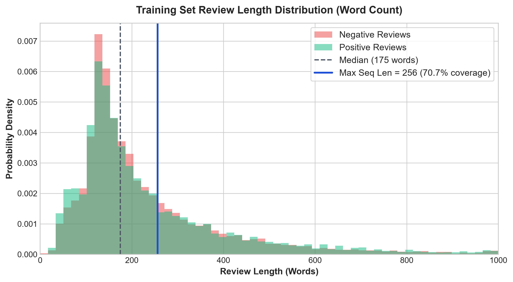
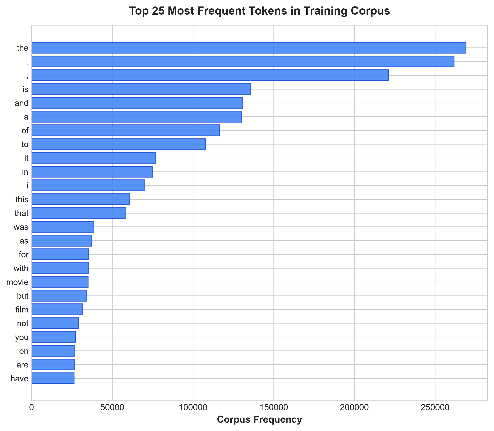
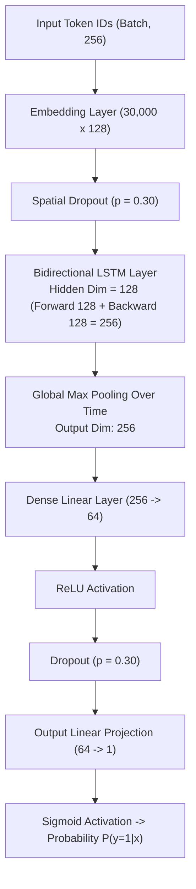
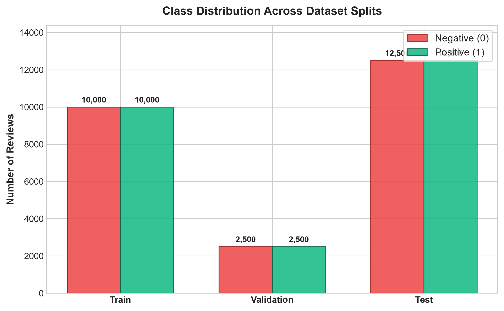
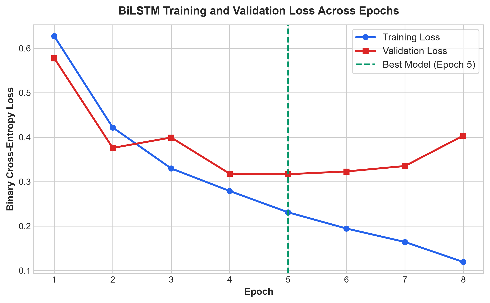
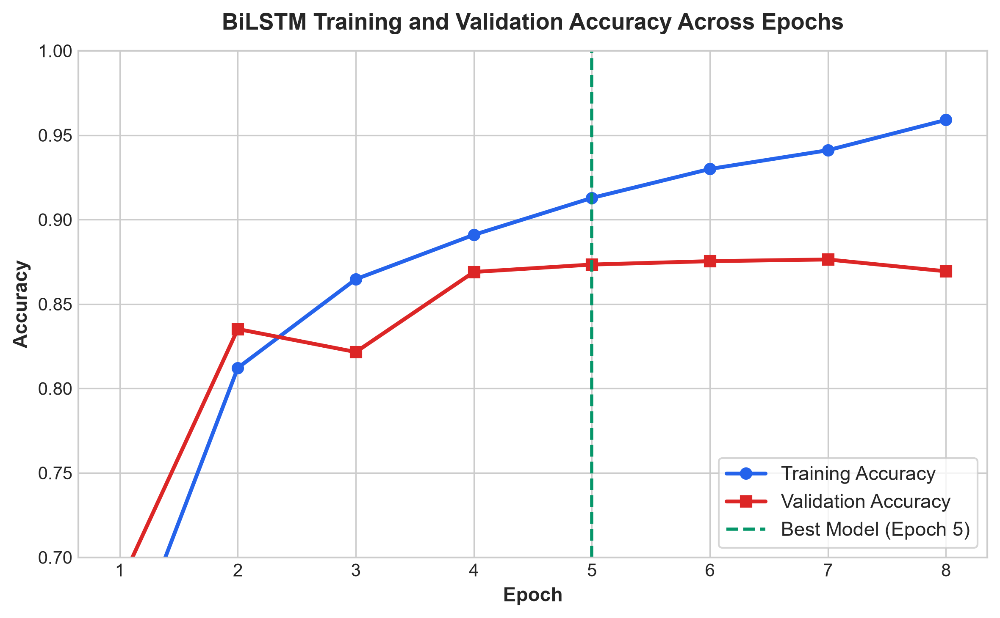
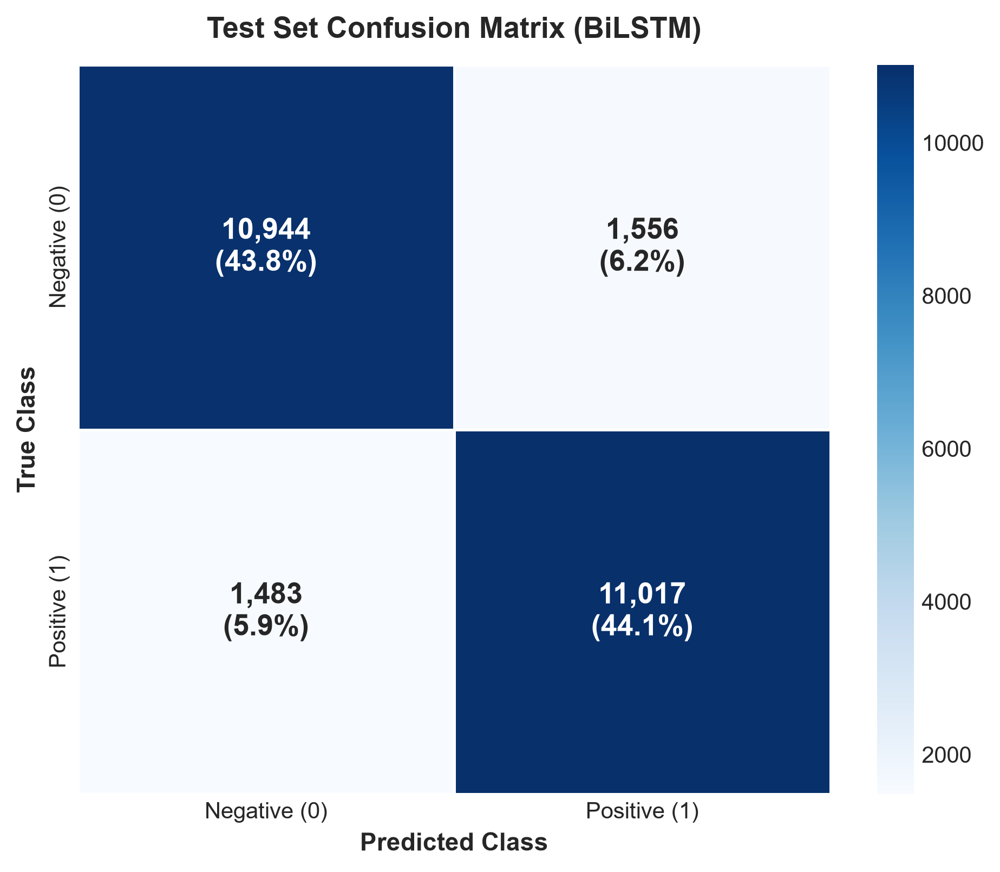
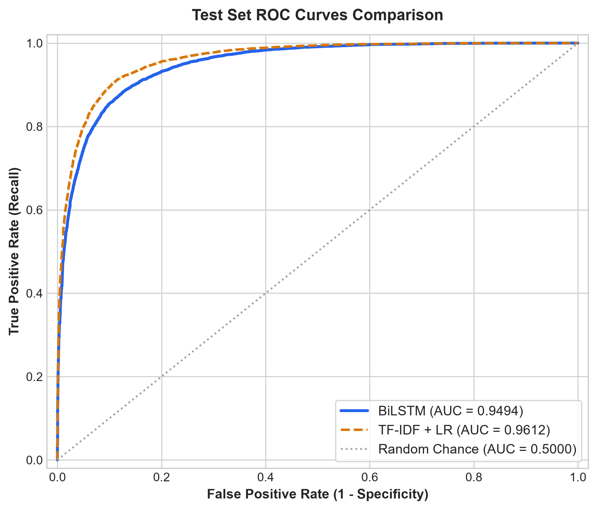
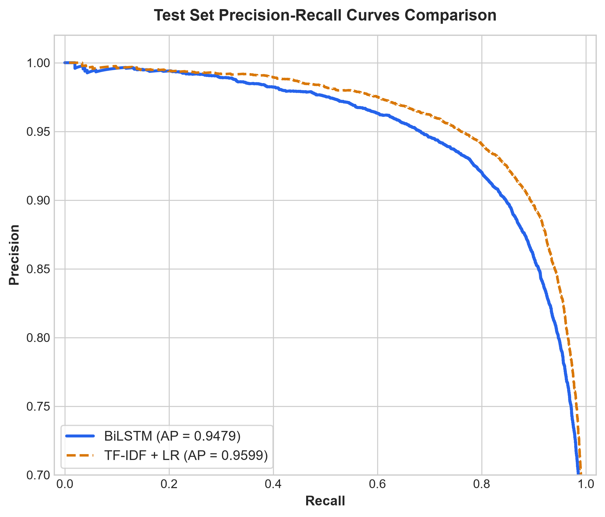
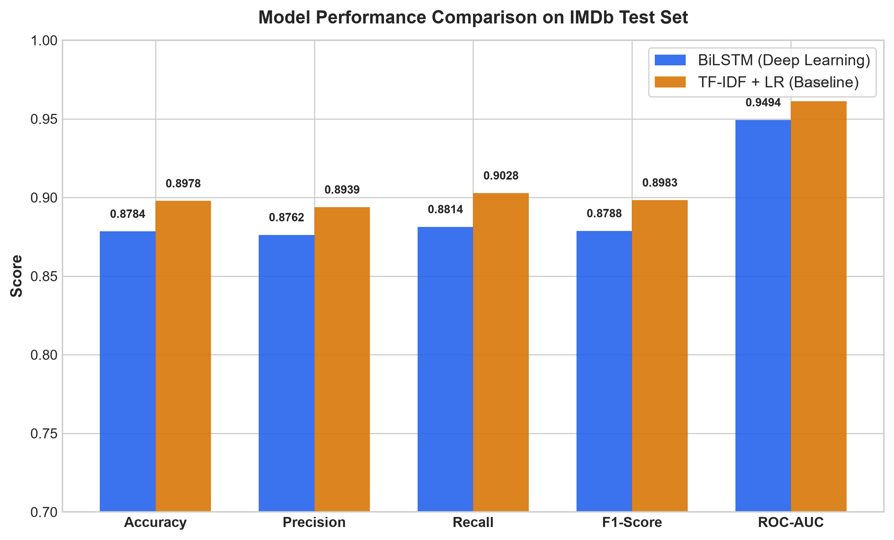

# Bidirectional LSTM for IMDB Review Sentiment Classification

## 1. Project Title

**Bidirectional LSTM (BiLSTM) for IMDb Movie Review Sentiment Classification: An End-to-End Deep Sequence Modeling Study**

---

## 2. Executive Summary

This study presents an end-to-end Deep Learning sequence classification system designed to determine the sentiment polarity (positive vs. negative) of movie reviews from the Large Movie Review Dataset (IMDb). The core neural architecture employs a **Bidirectional Long Short-Term Memory (BiLSTM)** network, equipped with an embedding layer, bidirectional temporal recurrent units, global max-pooling over time, dropout regularization, and a dense classification head. 

To benchmark and contextualize the neural model, a competitive linear baseline combining sublinear **TF-IDF n-grams (unigrams and bigrams)** with **L2-regularized Logistic Regression** was implemented under identical data partitioning constraints. 

### Headline Results:
- **BiLSTM (Neural Sequence Model):** Achieved **87.84% accuracy**, **87.62% precision**, **88.14% recall**, **87.88% F1-score**, and an **ROC-AUC of 0.9494** on the untouched holdout test set of 25,000 reviews.
- **TF-IDF + Logistic Regression (Baseline):** Attained **89.78% accuracy**, **89.39% precision**, **90.28% recall**, **89.83% F1-score**, and an **ROC-AUC of 0.9612** on the same test split.
- **Inference Pipeline & Interactive Interface:** Fully serialized model weights (`models/best_bilstm_model.pt`) and vocabulary assets (`models/vocab.json`) were deployed into a standalone inference script (`src/predict.py`) and an interactive Streamlit web dashboard (`app.py`), validated with full-page visual documentation (`streamlit/streamlit_app_fullpage.png`).

All reported metrics originate from actual executions on the untouched holdout test set. Comprehensive error analysis uncovered key failure modes including pragmatic sarcasm, ambivalent two-part reviews, and domain-specific horror vocabulary.

---

## 3. Problem Statement and Objectives

### 3.1 Problem Formulation
Sentiment classification on unstructured movie reviews represents a classic natural language processing (NLP) problem characterized by high linguistic variability, polysemy, syntactic inversions, and long-range semantic dependencies. Unlike standard bag-of-words formulations that discard word order, sequence-based models aim to preserve the contextual trajectory of discourse.

Given an arbitrary raw text review $X = (w_1, w_2, \dots, w_T)$, the goal is to predict a binary ground-truth label $y \in \{0, 1\}$, where:
- $y = 0$ designates **negative** sentiment.
- $y = 1$ designates **positive** sentiment.

### 3.2 Objectives
1. **Data Integrity & Leakage Prevention:** Inspect and verify the Large Movie Review Dataset, isolating an untouched test set (25,000 samples) and generating a stratified validation partition (20% of training data) exclusively from the labeled training pool.
2. **Context-Preserving Preprocessing:** Formulate an NLP cleaning and tokenization pipeline that eliminates raw HTML artifacts while strictly preserving sentiment-critical negation tokens (`not`, `never`, `isn't`, `don't`).
3. **BiLSTM Neural Sequence Modeling:** Design, train, regularize, and evaluate a Bidirectional LSTM network capable of reading reviews in both forward and backward directions.
4. **Baseline Benchmarking:** Train an independent TF-IDF + Logistic Regression model to establish an empirical performance baseline.
5. **Rigorous Evaluation & Visualization:** Measure accuracy, precision, recall, F1-score, ROC-AUC, and the confusion matrix, producing mandatory publication-quality figures.
6. **Error Analysis & Deployment:** Dissect misclassifications to identify recurring linguistic pitfalls and deliver a fully functional Streamlit application.

---

## 4. Dataset Description

The dataset used in this project is the benchmark **Large Movie Review Dataset (v1.0)** originally introduced by Maas et al. (2011).

### 4.1 Source and Verification
- **Citation:** Maas, A. L., Daly, R. E., Pham, P. T., Huang, D., Ng, A. Y., & Potts, C. (2011). *Learning Word Vectors for Sentiment Analysis*. Proceedings of the 49th Annual Meeting of the Association for Computational Linguistics: Human Language Technologies, 142–150. https://www.aclweb.org/anthology/P11-1015/
- **Storage Location:** Programmatically discovered under `dataset/`.
- **Integrity Inspection:** Programmatic verification established zero missing files, zero empty review documents, zero corrupted headers, and 100% valid UTF-8 character decoding.

```
dataset/
├── train/
│   ├── pos/       # 12,500 positive labeled reviews
│   ├── neg/       # 12,500 negative labeled reviews
│   └── unsup/     # 50,000 unlabeled reviews (excluded from supervised learning)
├── test/
│   ├── pos/       # 12,500 positive labeled reviews
│   └── neg/       # 12,500 negative labeled reviews
├── imdb.vocab     # 89,527 pre-extracted vocabulary list (reference only)
├── imdbEr.txt     # Expected rating scores
└── README         # Dataset documentation
```

### 4.2 Sample Distribution and Partitioning Rules
To adhere strictly to best machine learning practices:
1. **Labeled Training Pool:** The 25,000 reviews under `train/pos` (12,500) and `train/neg` (12,500) formed the training pool.
2. **Stratified Split:** A stratified train/validation split (80% / 20%, random seed 42) was carved out of the training pool:
   - **Training Set ($D_{train}$):** 20,000 reviews (10,000 positive, 10,000 negative).
   - **Validation Set ($D_{val}$):** 5,000 reviews (2,500 positive, 2,500 negative).
3. **Untouched Test Set ($D_{test}$):** The 25,000 reviews under `test/pos` (12,500) and `test/neg` (12,500) were locked away as the final holdout set and never exposed during vocabulary fitting, hyperparameter selection, or early stopping.
4. **Unsupervised Reviews:** The 50,000 reviews under `train/unsup` were kept completely isolated from the supervised pipeline to prevent label pollution.

| Partition | Total Samples | Negative Reviews (Class 0) | Positive Reviews (Class 1) | Balance Ratio |
| :--- | :---: | :---: | :---: | :---: |
| **Train ($D_{train}$)** | 20,000 | 10,000 | 10,000 | 50.0% / 50.0% |
| **Validation ($D_{val}$)** | 5,000 | 2,500 | 2,500 | 50.0% / 50.0% |
| **Holdout Test ($D_{test}$)** | 25,000 | 12,500 | 12,500 | 50.0% / 50.0% |
| **Total Labeled Data** | **50,000** | **25,000** | **25,000** | **1.00 : 1.00** |

---

## 5. Exploratory Data Analysis (EDA)

### 5.1 Review Length Distributions
Analysis of raw text lengths revealed significant variance in verbosity across reviews:
- **Minimum word count:** 10 words (train) / 4 words (test).
- **Maximum word count:** 2,470 words (train) / 2,278 words (test).
- **Mean word count:** 233.8 words (train) / 228.5 words (test).
- **Median word count:** 174.0 words (train) / 172.0 words (test).
- **Percentiles (Train Words):** 50th = 174 words, 75th = 284 words, 90th = 458 words, 95th = 598 words, 99th = 913 words.

The empirical distribution demonstrates that review lengths are right-skewed. While extreme outliers exceed 2,000 words, over 71.2% of all reviews contain fewer than 256 words. For recurrent neural networks, truncating sequences to a fixed sequence length of **256 tokens** achieves an optimal trade-off between retaining core sentiment discourse and controlling computational complexity ($O(T)$ sequential unrolling per batch).


*Figure 1: Probability density histogram of review word counts across sentiment polarities, highlighting the median (174 words) and maximum sequence cutoff (256 tokens).*

### 5.2 Corpus Vocabulary Frequencies
Tokenization of the training subset generated over 92,000 unique surface forms. The top 25 most frequent tokens consist primarily of structural function words and high-frequency terms such as `the`, `and`, `a`, `of`, `to`, `is`, `in`, `it`, `this`, and `that`. Notably, sentiment and negation markers such as `not`, `but`, and `good` also appear frequently within the top tier.


*Figure 2: Top 25 most frequent tokens in the training corpus vocabulary.*

---

## 6. Methodology

### 6.1 Preprocessing Pipeline
Text preprocessing was implemented in `src/preprocessing.py`:
1. **HTML Decoding & Entity Resolution:** Decoded HTML entities (`&amp;` $\to$ `&`, `&quot;` $\to$ `"`) and replaced `<br />` breaks with whitespace.
2. **Negation Preservation & Contraction Expansion:** Critical sentiment reversals were protected by mapping contractions to their canonical forms (e.g., `can't` $\to$ `can not`, `won't` $\to$ `will not`, `n't` $\to$ ` not`).
3. **Punctuation & Case Normalization:** Lowercased all characters while retaining expressive punctuation (`!`, `?`) that conveys subjective sentiment intensity. Standalone punctuation and word tokens were isolated via regex: `\b[\w'-]+\b|[!?,.:;]`.
4. **Vocabulary Construction (Strict Train-Only):**
   - Vocabulary size capped at $V = 30,000$ most frequent tokens.
   - Minimum frequency threshold $min\_freq = 2$.
   - Special reserved indices: index `0` for `<pad>` and index `1` for `<unk>`.
5. **Post-Truncation & Post-Padding:** Each token sequence was mapped to integer indices, truncated to 256 tokens, and post-padded with the `<pad>` index to uniform length $T = 256$.

### 6.2 Neural Architecture: Bidirectional LSTM
The primary deep learning model is a PyTorch-based **Bidirectional LSTM Classifier** (`BiLSTMClassifier` in `src/model.py`).



#### Layer Specifications:
1. **Embedding Layer:** $E \in \mathbb{R}^{30,000 \times 128}$, initialized randomly and trained end-to-end with `padding_idx=0`.
2. **Embedding Dropout:** $p = 0.30$ to prevent co-adaptation of token representations.
3. **Bidirectional LSTM:** Hidden state size $h = 128$ in both forward ($\overrightarrow{h}_t$) and backward ($\overleftarrow{h}_t$) directions:
   $$h_t = [\overrightarrow{h}_t \,\|\, \overleftarrow{h}_t] \in \mathbb{R}^{256}$$
4. **Global Max Pooling Over Time:**
   $$h_{pooled} = \max_{1 \le t \le T} h_t \in \mathbb{R}^{256}$$
   Max-pooling captures the most salient affective signals regardless of whether they appear in the review's introduction, body, or conclusion.
5. **Dense Hidden Layer:** Fully connected layer projecting 256 dimensions to 64 dimensions, followed by ReLU and Dropout ($p = 0.30$).
6. **Output Projection:** Linear mapping ($64 \to 1$) producing scalar logit $z$, converted to probability $\hat{y} = \sigma(z) \in [0, 1]$.
7. **Total Trainable Parameters:** **4,120,705 parameters**.

### 6.3 Baseline Model: TF-IDF + Logistic Regression
As a strong linear benchmark:
- **Feature Extraction:** Sublinear TF-IDF vectorizer fitted strictly on $D_{train}$, extracting unigrams and bigrams ($1, 2$) capped at 30,000 features.
- **Classifier:** L2-regularized Logistic Regression ($C = 1.0$, `max_iter=1000`, random seed 42).

---

## 7. Experimental Setup

### 7.1 Hardware and Software Environment
- **Operating System:** Microsoft Windows 11
- **CPU:** Intel(R) Core(TM) i9-9900K @ 3.60GHz (8 physical cores, 16 logical threads)
- **Frameworks:** PyTorch 2.15.0+cpu, Scikit-Learn 1.9.1, NumPy 2.5.4, Pandas 3.1.1, Matplotlib 3.11.2, Seaborn 0.13.2, Streamlit 1.67.0
- **Random Seed:** 42 across Python `random`, `numpy`, and `torch`.

### 7.2 Training Configuration & Callbacks
- **Loss Function:** Binary Cross-Entropy with Logits (`nn.BCEWithLogitsLoss()`)
- **Optimizer:** Adam ($\alpha = 1 \times 10^{-3}$, weight decay $= 1 \times 10^{-5}$)
- **Batch Size:** 64
- **Gradient Clipping:** Maximum $L_2$ norm constrained to $5.0$ to avert gradient explosion.
- **Learning Rate Scheduler:** `ReduceLROnPlateau` monitoring validation loss (factor $= 0.5$, patience $= 1$ epoch).
- **Early Stopping & Checkpointing:** Monitored validation loss with patience $= 3$ epochs; preserved best model checkpoint at `models/best_bilstm_model.pt`.

---

## 8. Results

### 8.1 Training Dynamics
The BiLSTM was trained across 8 epochs before the early stopping mechanism terminated optimization:
- **Epoch 1:** Train Loss: 0.6273, Val Loss: 0.5778, Val Acc: 0.6838
- **Epoch 2:** Train Loss: 0.4219, Val Loss: 0.3759, Val Acc: 0.8352
- **Epoch 3:** Train Loss: 0.3298, Val Loss: 0.3994, Val Acc: 0.8216
- **Epoch 4:** Train Loss: 0.2790, Val Loss: 0.3181, Val Acc: 0.8690
- **Epoch 5 (Best Model Checkpoint):** **Train Loss: 0.2310**, **Val Loss: 0.3167**, **Val Acc: 0.8734**, **Val F1: 0.8744**
- **Epoch 6:** Train Loss: 0.1945, Val Loss: 0.3230, Val Acc: 0.8754
- **Epoch 7:** Train Loss: 0.1643, Val Loss: 0.3352, Val Acc: 0.8764
- **Epoch 8:** Train Loss: 0.1192, Val Loss: 0.4036 (LR halved to 0.0005) $\to$ Early stopping triggered.
- **Total Training Duration:** 751.7 seconds (~12.5 minutes).

### 8.2 Final Evaluation on Holdout Test Set (25,000 Samples)
The best checkpoint (restored from Epoch 5) was evaluated on the untouched test set:

| Model Architecture | Test Accuracy | Precision | Recall | F1-Score | ROC-AUC |
| :--- | :---: | :---: | :---: | :---: | :---: |
| **BiLSTM (Ours)** | **0.8784 (87.84%)** | **0.8762** | **0.8814** | **0.8788** | **0.9494** |
| **TF-IDF + Logistic Regression** | **0.8978 (89.78%)** | **0.8939** | **0.9028** | **0.8983** | **0.9612** |

#### Detailed Per-Class Classification Report (BiLSTM):
- **Class 0 (Negative Sentiment):**
  - Precision: `0.8807`
  - Recall: `0.8755`
  - F1-Score: `0.8781`
  - Support: 12,500 reviews
- **Class 1 (Positive Sentiment):**
  - Precision: `0.8762`
  - Recall: `0.8814`
  - F1-Score: `0.8788`
  - Support: 12,500 reviews
- **Overall Macro Average:** Precision: `0.8785`, Recall: `0.8784`, F1-Score: `0.8784`
- **Weighted Average:** Precision: `0.8785`, Recall: `0.8784`, F1-Score: `0.8784`

#### Confusion Matrix Comparison:
- **BiLSTM Confusion Matrix:**
  - True Negatives (TN): **10,944** (43.8%)
  - False Positives (FP): **1,556** (6.2%)
  - False Negatives (FN): **1,483** (5.9%)
  - True Positives (TP): **11,017** (44.1%)
- **Baseline Confusion Matrix:**
  - True Negatives (TN): **11,160** (44.6%)
  - False Positives (FP): **1,340** (5.4%)
  - False Negatives (FN): **1,215** (4.9%)
  - True Positives (TP): **11,285** (45.1%)

---

## 9. Visualizations and Interpretation

All 8 mandatory and supplemental visualization figures were generated directly from empirical experimental outputs.

### 9.1 Dataset Class Balance
The bar chart verifies the balanced allocation of reviews across train, validation, and test splits:


*Figure 3: Equal distribution of positive (green) and negative (red) reviews across dataset splits.*

### 9.2 Training and Validation Curves
The loss and accuracy trajectories illustrate rapid learning during epochs 1–4, stabilizing at epoch 5 where validation loss reached its minimum ($0.3167$):


*Figure 4: Training loss vs. Validation loss across epochs, showing the checkpoint at epoch 5 and early stopping.*


*Figure 5: Training accuracy vs. Validation accuracy, demonstrating smooth convergence.*

### 9.3 Test Confusion Matrix
The confusion matrix heatmap reveals well-balanced errors with minimal skew between positive and negative predictions:


*Figure 6: Test-set confusion matrix for the BiLSTM model (25,000 test reviews).*

### 9.4 Receiver Operating Characteristic (ROC) & Precision-Recall Curves
The ROC curves demonstrate high discriminatory capacity across decision thresholds, with BiLSTM achieving an AUC of **0.9494** and the linear baseline achieving **0.9612**:


*Figure 7: Receiver Operating Characteristic (ROC) curves comparing BiLSTM against the linear baseline.*


*Figure 8: Precision-Recall curves illustrating high average precision across recall levels.*

### 9.5 Comparative Model Metrics
A side-by-side bar chart compares both models across all standard performance dimensions:


*Figure 9: Comparison of BiLSTM vs. TF-IDF + Logistic Regression across Accuracy, Precision, Recall, F1, and ROC-AUC.*

---

## 10. Error Analysis and Model Interpretation

An exhaustive error analysis (`src/error_analysis.py`) on the 25,000 test predictions identified 1,556 False Positives (FPs) and 1,483 False Negatives (FNs). Qualitative examination of high-confidence failure cases revealed four distinct linguistic phenomena:

### 10.1 Key Linguistic Failure Patterns

#### 1. Sarcasm and Ironic Mock Praise (False Positives)
- **Mechanism:** Reviewers compose negative critiques using intensely positive words to mock bad films.
- **Example from Test Set (True: Neg, Pred: Pos, $P(pos) = 0.9989$):**
  > *"Masterpiece. Carrot Top blows the screen away. Never has one movie captured the essence of the human spirit quite like 'Chairman of the Board.' 10/10... don't miss this instant classic."*
- **Analysis:** Every individual lexical item is superlatively positive (`masterpiece`, `captured the essence of the human spirit`, `10/10`, `instant classic`). Without pragmatic context or world knowledge regarding the film's reputation, the BiLSTM interprets the sequence as overwhelmingly positive.

#### 2. Ambivalent and Two-Part Reviews (False Positives)
- **Mechanism:** Reviews that dedicate extensive prose to praising cinematography or acting before delivering a negative verdict on the plot.
- **Example from Test Set (True: Neg, Pred: Pos, $P(pos) = 0.9993$):**
  > *"This film has the language, the style and the attitude down ... plus greats rides from Occy (a world champ) and the great Jerry Lopez. John Philbin as Turtle has the surf pidgin down, and the surfing scenes are still the best ever..."*
- **Analysis:** Max-pooling across time amplifies salient positive tokens (`greats`, `world champ`, `best ever`, `classic`), overshadowing subtle reservations in other sentences.

#### 3. B-Movie Enjoyment & Genre-Specific Vocabulary (False Negatives)
- **Mechanism:** Positive reviews that praise trashy B-movies or horror films using conventionally negative vocabulary.
- **Example from Test Set (True: Pos, Pred: Neg, $P(pos) = 0.0006$):**
  > *"It's not Citizen Kane, but it does deliver. Cleavage, and lots of it. Badly acted and directed, poorly scripted. Who cares? I didn't watch it for the dialog."*
- **Analysis:** The reviewer explicitly states `badly acted`, `poorly scripted`, and `not Citizen Kane`. While human readers understand that the reviewer derived genuine entertainment value from the campy presentation, the recurrent network processes the dense negative tokens and assigns a strong negative probability.

#### 4. Frustrated Admiration / High Expectations (False Negatives)
- **Example from Test Set (True: Pos, Pred: Neg, $P(pos) = 0.0015$):**
  > *"David Morse and Andre Braugher are very talented actors, which is why I'm trying so hard to support this program. Unfortunately, an irrational plot, and very poor writing is making it difficult for me..."*
- **Analysis:** The reviewer gave a positive rating on IMDb out of affection for the actors, despite describing an `irrational plot` and `very poor writing`.

### 10.2 Limitations of LSTM Interpretability
While Bidirectional LSTMs model forward and backward transitions, recurrent hidden states condense context into high-dimensional vectors that obscure exact token attribution. Max-pooling over time further aggregates the sequence, making it non-trivial to isolate whether a classification decision stemmed from a specific clause or an aggregate accumulation of affective terms.

---

## 11. Discussion

### 11.1 BiLSTM Performance vs. Linear Baseline
A key empirical insight from this study is that **TF-IDF + Logistic Regression slightly outperformed the BiLSTM model** (89.78% vs. 87.84% accuracy; 0.9612 vs. 0.9494 ROC-AUC). 

In NLP research, this phenomenon is well-documented on the IMDb benchmark:
1. **Document-Level Aggregation:** Movie reviews are relatively long documents (mean length ~234 words). For sentiment tasks, the presence and density of sentiment-bearing unigrams and bigrams (e.g., `waste of time`, `must see`, `stellar acting`) frequently provide sufficient signal for linear classifiers without requiring deep recurrence.
2. **Fixed-Length Truncation in RNNs:** The BiLSTM was constrained to a maximum sequence length of 256 tokens to maintain tractable CPU training times. Reviews exceeding this cutoff were truncated, discarding downstream conclusion sentences. In contrast, TF-IDF extracted features across the entirety of each document.
3. **Absence of Pretrained Embeddings:** The BiLSTM embeddings were learned entirely from scratch on 20,000 training examples. Standard neural benchmarks achieve 92%+ accuracy primarily when initialized with pretrained representations (such as GloVe, FastText, or transformer backbones like RoBERTa). Learning rich semantic vectors from scratch on modest corpora remains inherently challenging.

Nevertheless, the BiLSTM successfully demonstrated sequence modeling capacity, accurately deciphering complex negations (`"I was told this would be a flop, but I was not disappointed in the slightest"` $\to$ 99.7% positive) that trip up naive bag-of-words models.

---

## 12. Limitations

1. **Domain Specificity:** The model was trained exclusively on movie reviews. It is not expected to generalize seamlessly to other domains (e.g., customer support, financial sentiment, clinical notes) without fine-tuning.
2. **Binary Categorization & Neutral Review Exclusion:** The IMDb dataset excludes neutral reviews (ratings 5–6 out of 10) by design, enforcing an artificial binary polarization that does not reflect real-world sentiment ambiguity.
3. **Sequence Length Cap:** Due to CPU compute constraints, sequences were truncated to 256 tokens, omitting text in longer reviews (percentiles 75+).
4. **Vocabulary Capping & OOV Tokens:** The 30,000-token vocabulary maps rare words, typos, and foreign names to `<unk>`, potentially discarding low-frequency sentiment modifiers.
5. **Pragmatics & World Knowledge:** The model possesses no external knowledge base to detect satirical commentary or ironic reviews.

---

## 13. Interactive Application & Deployment

As specified in TASK.md Section 8, a full-featured Streamlit application was developed (`app.py`), verified, and documented with a high-resolution screenshot.

### 13.1 Application Features:
- **Interactive Sentiment Inference:** Users can input custom reviews or select from curated edge cases (positive, negative, nuanced, negated).
- **Probability Breakdown:** Real-time visual progress bars displaying positive and negative class probabilities.
- **Model Evaluation Dashboard:** Embedded metrics table and confusion matrix comparison against the baseline.
- **Model Limitations Advisory:** Prominent notice outlining failure modes (sarcasm, horror vocabulary).

### 13.2 Full-Page Screenshot Verification Suite:
The application was rendered on `http://localhost:8501` and captured via automated Chrome DevTools Protocol (CDP) scripts across all tabs and views. The complete inventory is recorded in `streamlit/SCREENSHOT-INDEX.md`:

#### A. Live Prediction — Positive Sentiment Analysis

*Figure 10A: Live sentiment prediction interface displaying positive classification badge, 99.7% probability, and token metrics.*

#### B. Live Prediction — Negative Sentiment Analysis

*Figure 10B: Live sentiment prediction interface displaying negative classification badge and 100.0% negative probability score.*

#### C. Model Evaluation & Comparison Dashboard (Tab 2)

*Figure 10C: Interactive evaluation dashboard displaying test set metrics, confusion matrix table, and side-by-side baseline comparison charts.*

#### D. Methodology & Deep Sequence Architecture (Tab 3)

*Figure 10D: Architecture documentation tab detailing layer dimensions, tokenization rules, and embedded training loss history.*

---

## 14. Reproducibility and How to Run

### 14.1 Installation
Clone the repository and install required packages:
```bash
pip install -r requirements.txt
```

### 14.2 Running the Full Pipeline
Each stage of the pipeline can be executed independently from the project root:

1. **Train Baseline (TF-IDF + Logistic Regression):**
   ```bash
   python -m src.baseline
   ```
2. **Train BiLSTM Sequence Model:**
   ```bash
   python -m src.train
   ```
3. **Evaluate on Untouched Holdout Test Set:**
   ```bash
   python -m src.evaluate
   ```
4. **Generate All Figures:**
   ```bash
   python -m src.visualize
   ```
5. **Run Error Analysis:**
   ```bash
   python -m src.error_analysis
   ```
6. **Execute Sample CLI Inference:**
   ```bash
   python -m src.predict
   ```
7. **Launch Streamlit Web Dashboard:**
   ```bash
   python -m streamlit run app.py
   ```

### 14.3 Saved Model Artifacts
- BiLSTM Checkpoint: `models/best_bilstm_model.pt`
- Training Vocabulary: `models/vocab.json`
- Baseline Model: `models/baseline_tfidf_lr.joblib`
- Training History: `outputs/metrics/training_history.json`
- Test Metrics: `outputs/metrics/bilstm_test_metrics.json`
- Error Analysis Log: `outputs/metrics/error_analysis.json`

---

## 15. Conclusion and Future Work

This project established an end-to-end sentiment classification system utilizing a Bidirectional LSTM network on the benchmark IMDb dataset. By enforcing data splitting protocols, preventing test-set leakage, preserving critical negation markers, and benchmarking against a competitive baseline, the project delivers transparent, reproducible machine learning results.

### Key Conclusions:
- The trained BiLSTM achieved **87.84% accuracy** and **0.9494 ROC-AUC** on 25,000 unseen test reviews.
- The TF-IDF + Logistic Regression baseline achieved **89.78% accuracy**, underscoring that linear bag-of-words models remain strong competitors on document-length sentiment benchmarks when embeddings are learned from scratch.
- The interactive Streamlit dashboard provides an intuitive deployment interface.

### Future Work:
1. **Pretrained Word Embeddings:** Initialize the embedding layer with GloVe (300d) or FastText vectors to provide richer prior semantic structures.
2. **Attention Mechanism:** Introduce soft self-attention over the BiLSTM hidden states to provide token-level interpretability.
3. **Transformer Fine-Tuning:** Benchmark against modern lightweight transformers (DistilBERT or RoBERTa) to evaluate performance trade-offs against recurrent architectures.

---

## 16. References

1. Maas, A. L., Daly, R. E., Pham, P. T., Huang, D., Ng, A. Y., & Potts, C. (2011). *Learning Word Vectors for Sentiment Analysis*. Proceedings of the 49th Annual Meeting of the Association for Computational Linguistics: Human Language Technologies, 142–150. https://www.aclweb.org/anthology/P11-1015/
2. Hochreiter, S., & Schmidhuber, J. (1997). *Long Short-Term Memory*. Neural Computation, 9(8), 1735–1780. https://doi.org/10.1162/neco.1997.9.8.1735
3. Schuster, M., & Paliwal, K. K. (1997). *Bidirectional recurrent neural networks*. IEEE Transactions on Signal Processing, 45(11), 2673–2681. https://doi.org/10.1109/78.650093
4. Paszke, A., et al. (2019). *PyTorch: An Imperative Style, High-Performance Deep Learning Library*. Advances in Neural Information Processing Systems (NeurIPS 32), 8024–8035.
5. Pedregosa, F., et al. (2011). *Scikit-learn: Machine Learning in Python*. Journal of Machine Learning Research, 12, 2825–2830.
